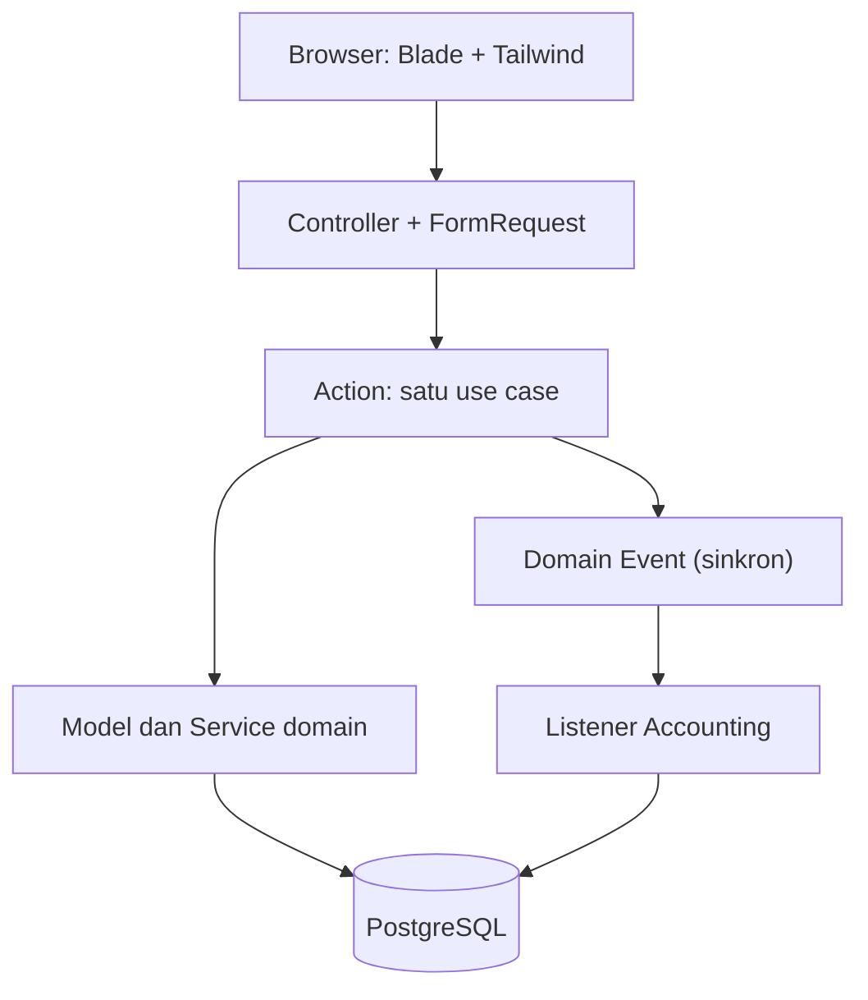
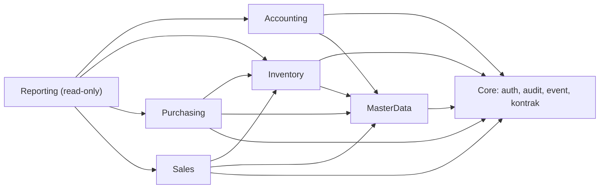
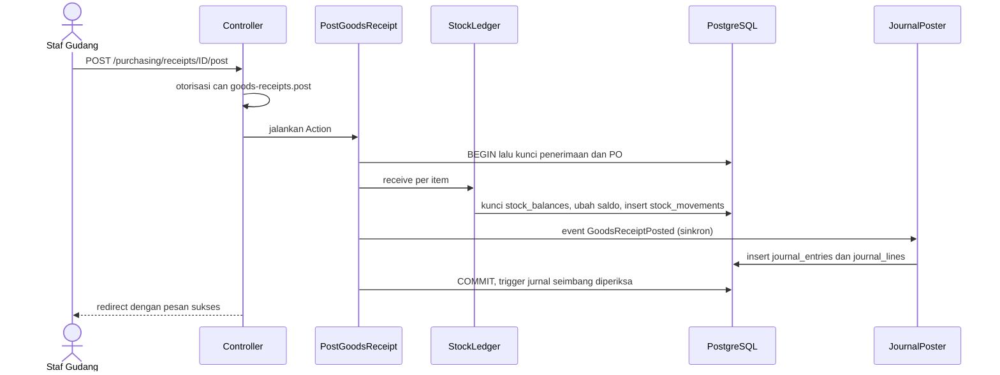
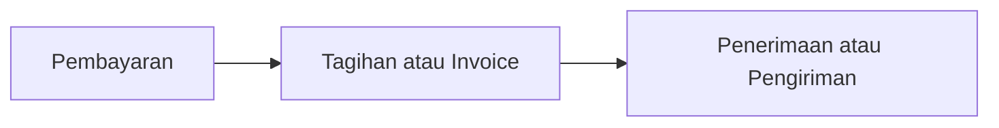

# MiniERP: Arsitektur

**Versi:** 1.0 | **Status:** Draft | **Tanggal:** 15 Oktober 2026

Dokumen terkait: [PRD](./PRD.md) · [DATABASE](./DATABASE.md)

Dokumen ini menjelaskan bagaimana aplikasi disusun dan mengapa. Skema tabel, constraint, dan trigger ada di [DATABASE](./DATABASE.md).

---

## 1. Prinsip

1. **Satu use case, satu Action.** Setiap aksi bisnis (konfirmasi PO, posting penerimaan, balik pembayaran) adalah satu class dengan satu transaksi database.
2. **Semua yang berubah, berubah bersama.** Stok, saldo, status dokumen, dan jurnal diperbarui dalam satu `DB::transaction`. Gagal di mana pun berarti batal semuanya.
3. **Modular monolith.** Satu aplikasi, beberapa modul dengan batas jelas. Aturan dependensi dicek otomatis oleh Deptrac di CI.
4. **Modul tidak saling membaca tabel.** Modul berkomunikasi lewat kontrak (interface) dan domain event. Accounting tidak pernah membaca tabel Purchasing.
5. **Pertahanan berlapis.** Aturan penting dijaga di aplikasi dan di database (constraint dan trigger).
6. **Satu sumber kebenaran untuk konfigurasi.** Menu, izin, dan label status masing-masing berada di satu file `config/`.

## 2. Stack

| Lapisan | Pilihan | Catatan |
|---|---|---|
| Framework | Laravel | Spec saat ini menyebut Laravel 10. Pertimbangkan naik ke versi yang masih menerima update keamanan sebelum rilis publik |
| Bahasa | PHP 8.2 atau lebih baru | Enum native, readonly property |
| Database | PostgreSQL 16 atau lebih baru | Trigger, partial index, window function |
| UI | Blade + Tailwind CSS (+ Alpine bila diperlukan) | Server-rendered. Tanpa SPA |
| Otorisasi | `spatie/laravel-permission` | RBAC per aksi |
| Perhitungan uang | String desimal dan `brick/math` | `brick/math` sudah ikut dependensi Laravel. Jangan float |
| Tes | Pest atau PHPUnit | Pada PostgreSQL asli |
| Kualitas kode | Pint, Larastan (PHPStan), Deptrac | Wajib hijau di CI |
| Antrean dan cache | Redis (opsional) | Tidak diperlukan oleh alur inti |
| Kontainer | Docker Compose | `app`, `nginx`, `postgres` (+ `redis`) |
| CI/CD | GitHub Actions | Lihat bagian 14 |

REST API (`/api/v1`, Sanctum, OpenAPI) adalah target Should di PRD (US-52). Alur inti tidak bergantung padanya, jadi dikerjakan setelah modul inti selesai.

## 3. Gambaran lapisan



| Lapisan | Tugas | Tidak boleh |
|---|---|---|
| Controller + FormRequest | Validasi input, otorisasi (`can:`), memanggil Action, memilih view | Berisi logika bisnis atau query kompleks |
| Action | Satu use case. Membuka transaksi, mengunci baris, memeriksa status, memanggil service, memicu event | Mengakses tabel modul lain |
| Service domain | Logika yang dipakai ulang (StockLedger, JournalPoster, DocumentNumbering) | Mengetahui HTTP |
| Model | Relasi, scope, cast, aturan status sederhana | Menyimpan logika lintas dokumen |
| Listener | Bereaksi pada event (membuat jurnal) | Dijalankan lewat antrean (harus sinkron) |

## 4. Struktur direktori

```
app/
├── Domain/
│   ├── Core/            Contracts (PeriodGuard, ...), Events, Auditing, Numbering, Support (Money)
│   ├── MasterData/      Models, Actions
│   ├── Inventory/       Models, Actions, Services (StockLedger), Enums, DTO
│   ├── Purchasing/      Models, Actions, Enums, Events (dipublikasikan lewat Core)
│   ├── Sales/           Models, Actions, Enums
│   ├── Accounting/      Models, Actions, Services (JournalPoster), Listeners
│   └── Reporting/       Query object (read-only)
├── Http/
│   ├── Controllers/<Module>/
│   ├── Requests/<Module>/
│   └── Middleware/      EnsureUserIsActive
├── Providers/           morph map, Gate::before, binding kontrak
config/
├── navigation.php       menu, judul, subjudul, tombol utama, izin
├── permissions.php      daftar izin dan matriks role
├── statuses.php         nilai status DB → label Indonesia, warna badge
└── accounting.php       pemetaan event → akun (system_key)
database/
├── migrations/          urutan di DATABASE.md bagian 11
└── seeders/
resources/views/
├── layouts/app.blade.php
├── components/layout/sidebar.blade.php
├── components/ui/       page-header, status-badge
└── <module>/<resource>/ index, create, edit, show, form
tests/
├── Unit/                moving average, state machine, pembulatan
├── Feature/             alur dokumen, otorisasi
├── Concurrency/         proses paralel pada PostgreSQL
└── Invariants/          neraca seimbang, nilai persediaan sama
```

Konvensi view: satu folder per resource, dan hanya berisi `index`, `create`, `edit`, `show`, `form`. Tidak ada file berawalan garis bawah dan tidak ada folder `partials/` untuk halaman.

## 5. Modul dan aturan dependensi

| Modul | Tanggung jawab |
|---|---|
| Core | Auth dan RBAC, audit, penomoran dokumen, kontrak, domain event, helper uang |
| MasterData | Produk, gudang, mitra, akun |
| Inventory | Stok (ledger dan saldo), opname, transfer |
| Purchasing | PO, penerimaan, tagihan, pembayaran ke supplier |
| Sales | SO, pengiriman, invoice, pembayaran dari customer |
| Accounting | Periode, jurnal (otomatis dan manual), reversal jurnal |
| Reporting | Laporan dan dashboard (hanya membaca) |



Aturan Deptrac:

1. Panah di atas satu-satunya arah yang diizinkan. Tidak ada modul yang bergantung pada Reporting.
2. **Accounting hanya bergantung pada Core dan MasterData.** Class event milik Core, jadi Accounting tidak mengimpor class Purchasing atau Sales.
3. Purchasing dan Sales memanggil Inventory lewat kontrak `StockLedger`, bukan lewat model stok.
4. Cek periode (BR-09) di Purchasing, Sales, dan Inventory memakai kontrak `PeriodGuard` milik Core. Accounting yang mengimplementasikannya. Dengan begitu tidak ada modul yang bergantung pada Accounting.

## 6. Pola Action dan transaksi

Contoh posting penerimaan barang:

```php
final class PostGoodsReceipt
{
    public function __construct(
        private StockLedger $stock,   // kontrak Inventory
        private PeriodGuard $periods, // kontrak Core, diimplementasi Accounting
    ) {}

    public function __invoke(int $receiptId, User $by): GoodsReceipt
    {
        return DB::transaction(function () use ($receiptId, $by) {
            $receipt = GoodsReceipt::lockForUpdate()->with('items')->findOrFail($receiptId);

            if ($receipt->status === DocumentStatus::Posted) {
                return $receipt;                      // idempoten: klik ganda tidak berdampak
            }
            $receipt->assertStatus(DocumentStatus::Draft);
            $this->periods->assertOpen($receipt->receipt_date);

            $po = PurchaseOrder::lockForUpdate()->with('items')->findOrFail($receipt->purchase_order_id);
            $po->assertCanReceive();

            foreach ($receipt->items->sortBy('product_id') as $line) {    // urutan tetap, cegah deadlock
                $poItem = $po->items->firstWhere('id', $line->purchase_order_item_id);
                throw_if($line->qty_received > $poItem->remainingToReceive(), OverReceiptException::class);

                $this->stock->receive(new StockIn(
                    productId: $line->product_id,
                    warehouseId: $receipt->warehouse_id,
                    qty: $line->qty_received,
                    unitCost: $poItem->unit_price,
                    source: SourceRef::for($receipt),
                    occurredAt: $receipt->receipt_date,
                ));
                $poItem->increment('qty_received', $line->qty_received);
            }

            $po->refreshReceivingStatus();            // partial atau done
            $receipt->markPosted($by);

            event(new GoodsReceiptPosted($receipt->id));   // listener sinkron membuat jurnal
            return $receipt;
        }, attempts: 3);                              // ulangi bila terjadi deadlock
    }
}
```

Aturan untuk semua Action:

| Aturan | Alasan |
|---|---|
| Transaksi dibuka di Action, bukan di Controller | Satu use case sama dengan satu transaksi |
| Kunci dokumen dengan `lockForUpdate()` lebih dulu | Dua klik bersamaan menunggu giliran |
| Cek status sebelum bekerja, dan kembalikan hasil bila sudah selesai | Idempoten |
| Cek periode akuntansi sebelum mengubah apa pun | BR-09 |
| Kunci baris dalam urutan tetap | Mencegah deadlock |
| Event dipicu di akhir, di dalam transaksi | Jurnal ikut batal bila gagal |
| `attempts: 3` | Deadlock jarang terjadi, tetapi aman diulang |

## 7. Alur posting



## 8. Konkurensi

| Risiko | Pertahanan |
|---|---|
| Dua SO mereservasi stok yang sama | `lockForUpdate()` pada `stock_balances`, lalu cek available. Cadangan: CHECK `qty_reserved <= qty_on_hand` |
| Dua pengiriman mengurangi stok yang sama | Kunci yang sama. Cadangan: CHECK `qty_on_hand >= 0` |
| Klik ganda pada tombol posting | Kunci dokumen lalu cek status. Cadangan: unique `(source_type, source_id, kind)` pada jurnal |
| Klik ganda pada pembayaran | `idempotency_key` unique, ditambah kunci baris tagihan |
| Pembayaran melebihi sisa tagihan | Kunci baris tagihan. Cadangan: CHECK `amount_paid <= total` |
| Deadlock | Urutan kunci tetap (bagian di bawah), dan retry transaksi |
| Penomoran ganda | `document_sequences` dikunci, dan nomor unique di tiap tabel |

**Urutan penguncian (selalu sama):**
1. Dokumen utama (penerimaan, pengiriman, opname, dan sebagainya)
2. Dokumen induk (PO atau SO) dan itemnya
3. `stock_balances`, diurut berdasarkan (`product_id`, `warehouse_id`) naik
4. Tagihan atau invoice (untuk pembayaran)
5. `document_sequences` untuk nomor jurnal, paling akhir supaya kunci ini dipegang sesingkat mungkin

Konsekuensi: nomor jurnal per bulan diberikan berurutan, jadi pembuatan jurnal antar transaksi berjalan bergantian. Untuk skala mini ERP ini diterima.

## 9. Aturan perhitungan

### 9.1 Biaya rata-rata bergerak (BR-05, BR-11)

Nilai persediaan disimpan eksak di `stock_balances.total_value`. Biaya rata-rata hanya turunannya.

| Kejadian | Rumus |
|---|---|
| Masuk `q` dengan biaya `c` | `nilai_masuk = round(q × c, 2)`. `qty += q`, `total_value += nilai_masuk` |
| Keluar `q` | Bila `q = qty`, biaya keluar = seluruh `total_value`. Selain itu `biaya_keluar = round(total_value × q / qty, 2)`. Lalu `qty -= q`, `total_value -= biaya_keluar` |
| Tampilan | `avg_cost = round(total_value / qty, 4)` bila `qty > 0` |

Barang terakhir mengambil seluruh sisa nilai, jadi tidak pernah ada selisih pembulatan yang tertinggal.

**Contoh:** stok 120 Roll senilai Rp 81.600.000 (Rp 680.000 per roll). Terima 50 Roll @ Rp 675.000 = Rp 33.750.000. Saldo menjadi 170 Roll senilai Rp 115.350.000, rata-rata Rp 678.529,41. Kirim 20 Roll: biaya keluar `115.350.000 × 20 / 170 = Rp 13.570.588,24`. Sisa 150 Roll senilai Rp 101.779.411,76.

### 9.2 Reservasi stok (BR-10)

| Aksi | Efek |
|---|---|
| Konfirmasi SO | Untuk tiap item: harus `qty_on_hand - qty_reserved >= qty_ordered`, lalu `qty_reserved += qty_ordered`. Satu item kurang berarti gagal seluruhnya |
| Posting pengiriman | `qty_on_hand` dan `qty_reserved` sama-sama berkurang sebesar qty kirim. `qty_delivered` bertambah |
| Batal SO, atau tutup sisa | Sisa reservasi dilepas. Tutup sisa mengisi `closed_at` dan SO menjadi `done` |
| Opname atau transfer yang membuat `on_hand < reserved` | Ditolak oleh CHECK database. Pesan: "Stok dipakai reservasi" |

### 9.3 Reversal (BR-12, BR-13)

Dokumen yang sudah diposting tidak diedit. Koreksinya adalah reversal: mutasi stok pembalik dan jurnal pembalik, dalam transaksi yang sama. Dokumen yang dibalik bersifat final.

**Urutan wajib (dari yang paling akhir):**



| Dokumen | Syarat dibalik | Efek |
|---|---|---|
| Pembayaran | Selalu boleh (selama periode terbuka) | `amount_paid` turun, status tagihan menyesuaikan. Jurnal dibalik |
| Tagihan, Invoice | Tidak ada pembayaran aktif | Status `reversed`. Jurnal dibalik |
| Penerimaan | Tagihan sudah dibalik atau belum ada. Stok `on_hand - reserved >= qty`. Nilai persediaan setelah pembalikan tidak negatif, dan bila qty menjadi 0 nilainya harus 0 | Stok keluar sebesar nilai penerimaan. `qty_received` PO turun, status PO dihitung ulang |
| Pengiriman | Invoice sudah dibalik atau belum ada | Stok masuk kembali sebesar `line_cost` asli. `qty_delivered` turun. Reservasi dipulihkan bila SO belum ditutup |
| Opname, Transfer | Hasil pembalikan tidak melanggar CHECK stok | Mutasi berlawanan |
| Jurnal manual | Periode terbuka | Jurnal pembalik dengan debit dan kredit ditukar |

Syarat "tidak melanggar CHECK" artinya bila pembalikan akan membuat stok atau nilai menjadi tidak valid, aksi ditolak dengan pesan yang menjelaskan dokumen mana yang harus dibalik lebih dulu.

### 9.4 Penomoran dan pembulatan

- Nomor dokumen `PREFIX-YYYY-MM-NNNN` dari `document_sequences`, dibuat saat dokumen dibuat. Celah akibat draft yang dihapus diterima (BR-14).
- Pembulatan: setengah ke atas, 2 desimal untuk uang, 4 desimal untuk biaya satuan. Hitung dengan string desimal atau `brick/math`, bukan float.

## 10. Event dan jurnal otomatis

Event adalah class sederhana di `Core\Events` dan membawa id dokumen. Listener Accounting memuat data lewat kontrak, lalu membuat jurnal. Listener **tidak boleh** `ShouldQueue` dan tidak boleh ditunda sampai setelah commit, supaya jurnal berada di transaksi yang sama.

Pemetaan akun ada di `config/accounting.php` memakai `system_key`, bukan kode akun:

| Event | Debit | Kredit |
|---|---|---|
| `GoodsReceiptPosted` | `inventory` | `grir` |
| `VendorBillPosted` | `grir` | `payable` |
| `PaymentPosted` (keluar) | `payable` | akun kas atau bank yang dipilih |
| `DeliveryPosted` | `cogs` | `inventory` |
| `InvoicePosted` | `receivable` | `sales` |
| `PaymentPosted` (masuk) | akun kas atau bank yang dipilih | `receivable` |
| `StockOpnamePosted` (selisih lebih) | `inventory` | `inventory_adjustment` |
| `StockOpnamePosted` (selisih kurang) | `inventory_adjustment` | `inventory` |
| `StockTransferPosted` | tidak ada jurnal | tidak ada jurnal |
| `*Reversed` | jurnal pembalik dari jurnal asli (ditemukan lewat `source_type` dan `source_id`) | |

Penerimaan memakai akun perantara GR/IR (21200) karena tagihan dicatat terpisah. Tanpa itu, hutang akan terhitung dua kali.

Source type di database memakai kunci stabil (`goods_receipt`, `vendor_bill`, dan seterusnya) lewat morph map, bukan nama class PHP.

## 11. Otorisasi (RBAC)

- Izin bernama `<resource>.<action>` dan didefinisikan di `config/permissions.php`. Seeder menyinkronkannya ke database, sehingga idempoten.
- Role: Owner, Staf Gudang, Staf Penjualan, Staf Pembelian, Akuntan. Owner selalu mendapat semua izin dan juga lewat `Gate::before`.
- Route memakai middleware `can:<izin>`. View memakai `@can`. Jangan memakai middleware role atau permission bawaan Spatie, karena tidak melewati `Gate::before`.
- `config/navigation.php` menyimpan izin tiap item menu dan tombol, sehingga sidebar dan tombol tersaring otomatis.
- Halaman tanpa izin menampilkan 403 berbahasa Indonesia.
- Pengguna nonaktif ditolak saat login, dan sesi yang masih aktif diakhiri oleh middleware `EnsureUserIsActive`.
- Aksi di tingkat dokumen (misalnya posting hanya untuk dokumen draft) diperiksa di Action, bukan hanya di izin.

## 12. Audit

- Trait `Auditable` pada model transaksi dan master data mencatat `created`, `updated`, `deleted` beserta nilai lama dan baru.
- Action mencatat peristiwa bisnis (`confirmed`, `posted`, `reversed`, `cancelled`, `closed`) di transaksi yang sama, sehingga log ikut batal bila aksi gagal.
- `audit_logs` bersifat append-only (trigger). Isinya: pengguna, waktu, IP, dokumen, dan nilai lama atau baru.
- Perubahan pengguna dan role (pembuatan, nonaktif, perubahan izin) juga dicatat.

## 13. Arsitektur UI

- `layouts/app.blade.php` memuat sidebar, top bar (breadcrumb dan pintasan "Transaksi Baru"), dan slot konten.
- Sidebar accordion dibuat dari `config/navigation.php`. Satu grup terbuka, grup halaman aktif terbuka otomatis, dan item aktif ditentukan dari nama route (`routeIs('purchasing.orders', 'purchasing.orders.*')`).
- `<x-ui.page-header>` mengambil judul, subjudul, dan tombol utama dari konfigurasi lewat nama route. Setiap halaman punya paling banyak satu tombol utama.
- `<x-ui.status-badge>` mengubah nilai status DB menjadi label dan warna dari `config/statuses.php`. Tidak ada label status yang ditulis langsung di Blade. Badge "Jatuh Tempo" dihitung dari tanggal dan sisa tagihan.
- Halaman daftar: Controller menerima filter lewat FormRequest, query dibangun di query object, hasilnya dipaginasi. Gunakan eager loading untuk mencegah N+1.
- URL: satu halaman satu route, contoh `/purchasing/orders`. Halaman detail dan form berada di bawahnya (`/purchasing/orders/{id}`, `/create`, `/{id}/edit`). Aksi berupa POST ke `/{id}/confirm`, `/{id}/post`, `/{id}/reverse`, dan `/{id}/cancel`.
- Halaman detail dokumen memakai satu pola: header, stepper status, tabel item, satu tombol aksi utama, tab "Jurnal" dan "Riwayat".

## 14. Pengujian dan CI/CD

### 14.1 Tes

| Jenis | Isi |
|---|---|
| Unit | Moving average dan pembulatan, state machine dokumen, validator jurnal |
| Feature | PO → penerimaan → tagihan → bayar. SO → pengiriman → invoice → bayar. Kasus parsial dan reversal |
| Otorisasi | Tes berbasis tabel atas `config/navigation.php`: tiap role mendapat 200 atau 403 sesuai matriks |
| Konkurensi | 50 proses paralel mereservasi atau mengurangi stok yang sama pada PostgreSQL asli. Hasilnya tidak boleh minus |
| Invarian | Setelah rangkaian transaksi acak, I-1 sampai I-9 di DATABASE.md terpenuhi |
| Arsitektur | Deptrac dan tes bahwa listener tidak `ShouldQueue` |

Tes konkurensi menjalankan beberapa proses PHP (misalnya Symfony Process memanggil perintah Artisan khusus tes) terhadap database yang sama. Tes dalam satu proses dengan transaksi tidak bisa menguji kunci baris.

### 14.2 CI (GitHub Actions)

Urutan langkah:

1. Siapkan PHP 8.2 dan layanan `postgres:16`.
2. `composer install`, salin `.env.ci`, `php artisan key:generate`.
3. `vendor/bin/pint --test`.
4. `vendor/bin/phpstan analyse`.
5. `vendor/bin/deptrac analyse`.
6. `php artisan migrate --force`.
7. `vendor/bin/pest --coverage --min=80`.
8. `npm ci && npm run build`.

### 14.3 Operasional

- Docker Compose untuk pengembangan dan demo. Variabel penting: `DB_*`, `APP_TIMEZONE=Asia/Jakarta`, `DEMO_USER_PASSWORD` (wajib diganti di demo publik).
- Backup dengan `pg_dump` terjadwal.
- Halaman Kesehatan Sistem menjalankan pengecekan invarian (neraca seimbang, nilai persediaan sama dengan buku besar, tidak ada stok minus, urutan reversal valid).

## 15. Keputusan desain

| Keputusan | Alasan | Konsekuensi |
|---|---|---|
| Modular monolith | Cukup untuk skala ini, lebih sederhana daripada microservice | Perlu disiplin batas modul, dijaga Deptrac |
| Ledger stok dan saldo cache | Riwayat lengkap dan lookup cepat | Saldo harus diperbarui dalam transaksi yang sama (diuji lewat invarian I-5) |
| Event sinkron | Jurnal harus selalu konsisten dengan dokumen | Posting sedikit lebih lambat. Tidak bisa memakai antrean untuk jurnal |
| Akun GR/IR | Penerimaan dan tagihan terpisah | Satu akun tambahan, dan rekonsiliasi lewat invarian I-4 |
| Satu tagihan per penerimaan, satu invoice per pengiriman | Alur mudah dipahami dan diuji | Tagihan gabungan masuk backlog v2 |
| Reservasi stok saat konfirmasi SO | Mencegah SO dijanjikan melebihi stok | Tambahan kolom dan aturan pelepasan |
| `total_value` eksak | Tidak ada selisih pembulatan antara stok dan buku besar | Angka HPP dibulatkan per transaksi, bukan dari rata-rata yang sudah dibulatkan |
| Status Inggris di DB, label Indonesia di UI | Kode mudah dibaca, UI sesuai pengguna | Pemetaan terpusat di `config/statuses.php` |
| Trigger append-only | Jejak audit tidak bisa dimanipulasi dari aplikasi | Migration memakai SQL khusus PostgreSQL |
| Blade, bukan Filament | Kontrol penuh atas UI dan tidak terikat panel admin | Form dan tabel dibuat sendiri, dengan komponen bersama |
| Tanpa pajak di v1 | Mengurangi kompleksitas jurnal | PPN masuk backlog v2 |

## 16. Batasan v1

Satu mata uang dan satu perusahaan. Tanpa PPN, diskon, retur, batch atau serial number, dan tanpa tagihan gabungan. Tidak ada jurnal penutup tahunan (laba tahun berjalan belum dipindah ke Laba Ditahan). Tidak ada ekspor Excel atau PDF dan tidak ada notifikasi.

## 17. Urutan implementasi

Kondisi saat ini: kerangka UI, navigasi, dan RBAC sudah ada. Tabel bisnis, mesin stok, dan transaksi belum ada.

| Langkah | Hasil | Selesai bila |
|---|---|---|
| 1 | Migration (urutan 1 sampai 9 di DATABASE.md), model, `CoaSeeder`, penomoran dokumen | `migrate:fresh --seed` sukses, trigger menolak UPDATE jurnal |
| 2 | `StockLedger` dan reservasi | Tes konkurensi lulus, I-5 terpenuhi |
| 3 | `JournalPoster`, periode, dan jurnal manual | I-1 dan I-8 terpenuhi |
| 4 | Purchasing penuh: PO, penerimaan, tagihan, pembayaran, termasuk form, halaman detail, dan reversal | Alur lengkap lulus tes feature, I-2 sampai I-4 terpenuhi |
| 5 | Sales penuh, dengan pola yang sama | Alur lengkap dan reservasi lulus tes |
| 6 | Opname dan transfer | Stok awal bisa dimasukkan lewat opname |
| 7 | Laporan dan dashboard dari data nyata, `DemoDataSeeder` lewat Action | KPI dihitung dari data, spec diperbarui |
| 8 | Audit log, Kesehatan Sistem | Perubahan dokumen tercatat dengan nilai lama dan baru |
| 9 | CI, Docker, deploy, README | Pipeline hijau, demo publik berjalan |

Kerjakan satu alur sampai tuntas (langkah 4) sebelum melebar ke modul lain. Alur pertama menjadi pola untuk sisanya.

## 18. Catatan revisi terhadap PRD v1.1

PRD v1.1 perlu disesuaikan dengan hal-hal berikut:

- UI memakai **Blade dan Tailwind**, bukan Filament.
- Status **Draft** ada untuk PO, SO, pengiriman, tagihan, dan invoice. Himpunan status mengikuti `config/statuses.php`.
- **RBAC:** lima role dengan izin `<resource>.<action>`, Owner menggantikan "Owner/Admin".
- **Pembayaran** satu tabel dua arah, dengan akun kas atau bank (11110 Bank ditambahkan).
- **Mitra** adalah nama menu untuk partner. **Tagihan** adalah nama menu untuk vendor bill.
- Syarat **reversal penerimaan dan pengiriman** (bagian 9.3) dan **tutup sisa** pada PO dan SO.
