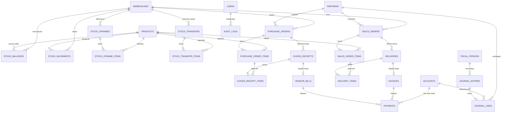

# MiniERP: Desain Database

**Versi:** 1.0 | **Status:** Draft | **Tanggal:** 15 Oktober 2026 | **DBMS:** PostgreSQL 16 atau lebih baru

Dokumen terkait: [PRD](./PRD.md) · [ARCHITECTURE](./ARCHITECTURE.md)

Dokumen ini adalah peta untuk migration. Aturan perhitungan (moving average, reservasi, reversal) dijelaskan di [ARCHITECTURE](./ARCHITECTURE.md). Dokumen ini fokus pada tabel, constraint, dan invarian yang dijaga database.

---

## 1. Prinsip desain

1. **Stok adalah ledger.** `stock_movements` bersifat append-only. `stock_balances` hanyalah cache yang diperbarui dalam transaksi yang sama.
2. **Jurnal tidak bisa diubah.** `journal_lines` tidak boleh di-UPDATE atau DELETE. Koreksi lewat jurnal pembalik.
3. **Database ikut menjaga aturan penting**, bukan hanya aplikasi: stok tidak minus, jurnal seimbang, periode tertutup menolak jurnal. Aplikasi bisa punya bug, constraint tidak.
4. **Nilai DB berbahasa Inggris, label UI berbahasa Indonesia.** Status disimpan sebagai `confirmed`, dan label "Dikonfirmasi" dipetakan di `config/statuses.php`.
5. **Tanpa pajak (PPN) di v1.** Total dokumen sama dengan subtotal.
6. **Data master tidak dihapus**, hanya dinonaktifkan (`is_active`). Dokumen draft boleh dihapus. Dokumen yang pernah diposting tidak boleh.

## 2. Konvensi

| Hal | Aturan |
|---|---|
| Primary key | `id` bigint identity |
| Uang | `numeric(18,2)`. Jangan pernah float |
| Biaya satuan | `numeric(18,4)` |
| Kuantitas | `numeric(18,4)` |
| Status | `varchar` dengan CHECK constraint (bukan enum PostgreSQL, supaya migration mudah) |
| Tanggal dokumen | `date`. Waktu kejadian `timestamp` |
| Zona waktu | `APP_TIMEZONE=Asia/Jakarta` |
| Nama tabel | snake_case, jamak. Nama kolom Inggris |
| Foreign key | `restrictOnDelete` semua, tanpa cascade pada data transaksi |
| Nomor dokumen | `PREFIX-YYYY-MM-NNNN`, contoh `PO-2026-10-0042`. Dibuat saat dokumen dibuat |

**Prefix nomor:** PO (purchase order), GR (penerimaan), VB (tagihan supplier), PV (pembayaran ke supplier), SO (sales order), DO (pengiriman), INV (invoice), RC (pembayaran dari customer), OP (opname), TF (transfer), JRN (jurnal).

**Kolom umum dokumen** (tidak diulang di tabel di bawah):

| Kolom | Tipe | Catatan |
|---|---|---|
| `number` | varchar(30) unique | Nomor dokumen |
| `status` | varchar(20) | Lihat bagian 5 |
| `notes` | text null | Catatan |
| `created_by` | FK users | Pembuat |
| `posted_by`, `posted_at` | FK users null, timestamp null | Diisi saat posting (atau konfirmasi pada PO dan SO) |
| `reversed_by`, `reversed_at` | FK users null, timestamp null | Diisi saat dibalik |
| `created_at`, `updated_at` | timestamp | |

PO dan SO memakai `confirmed_by/at`, `cancelled_by/at`, dan `closed_by/at` (tutup sisa), bukan `posted_*` dan `reversed_*`.

## 3. ERD

Hanya relasi. Kolom ada di bagian 4. Relasi polimorfik (`source_type` dan `source_id` di `stock_movements` dan `journal_entries`) tidak digambar.



## 4. Kamus tabel

### 4.1 Pengguna dan hak akses

**`users`**

| Kolom | Tipe | Catatan |
|---|---|---|
| `name` | varchar(120) | |
| `email` | varchar(190) unique | |
| `password` | varchar(255) | Hash |
| `is_active` | boolean default true | Pengguna nonaktif tidak bisa login |
| `last_login_at` | timestamp null | |
| `remember_token`, timestamps | | Bawaan Laravel |

Tabel `roles`, `permissions`, `model_has_roles`, `model_has_permissions`, `role_has_permissions` berasal dari `spatie/laravel-permission`. Role: Owner, Staf Gudang, Staf Penjualan, Staf Pembelian, Akuntan. Nama izin `<resource>.<action>` didefinisikan di `config/permissions.php`.

### 4.2 Master data

**`products`**

| Kolom | Tipe | Catatan |
|---|---|---|
| `sku` | varchar(40) unique | |
| `name` | varchar(190) | |
| `unit` | varchar(20) | Roll, Pcs, Pail, Sak |
| `purchase_price` | numeric(18,2) default 0 | Harga acuan di PO. Biaya rata-rata ada di `stock_balances` |
| `sale_price` | numeric(18,2) default 0 | Harga acuan di SO |
| `min_stock` | numeric(18,4) default 0 | Batas "Stok Menipis" |
| `is_active` | boolean default true | |

**`warehouses`**: `code` varchar(20) unique, `name` varchar(120), `address` text null, `is_active`.

**`partners`**

| Kolom | Tipe | Catatan |
|---|---|---|
| `code` | varchar(20) unique | CUST-0056, VEND-0124 |
| `name` | varchar(190) | |
| `type` | varchar(10) | `customer` atau `supplier` |
| `phone`, `email`, `address` | null | Kolom "Kontak" di UI memakai `phone` |
| `payment_term_days` | smallint default 0 | 0 berarti tunai. Menentukan jatuh tempo |
| `is_active` | boolean default true | |

**`accounts`** (Chart of Accounts)

| Kolom | Tipe | Catatan |
|---|---|---|
| `code` | varchar(10) unique | |
| `name` | varchar(150) | |
| `type` | varchar(10) | `asset`, `liability`, `equity`, `revenue`, `cogs`, `expense` |
| `normal_balance` | varchar(6) | `debit` atau `credit` |
| `system_key` | varchar(30) null unique | Akun yang dipakai jurnal otomatis. Tidak boleh dinonaktifkan atau diganti kodenya |
| `is_active` | boolean default true | |

**`fiscal_periods`**

| Kolom | Tipe | Catatan |
|---|---|---|
| `year`, `month` | smallint | Unique bersama |
| `start_date`, `end_date` | date | |
| `status` | varchar(10) default `open` | `open` atau `closed` |
| `closed_by`, `closed_at` | FK null, timestamp null | |

**`document_sequences`**: `doc_type` varchar(10), `period` char(6) (`YYYYMM`), `last_number` integer default 0. Unique (`doc_type`, `period`). Dikunci dengan `lockForUpdate()` saat membuat nomor.

### 4.3 Inventory

**`stock_balances`** (cache saldo, satu baris per produk per gudang)

| Kolom | Tipe | Catatan |
|---|---|---|
| `product_id`, `warehouse_id` | FK | Unique bersama |
| `qty_on_hand` | numeric(18,4) default 0 | |
| `qty_reserved` | numeric(18,4) default 0 | Reservasi dari SO terkonfirmasi |
| `total_value` | numeric(18,2) default 0 | Nilai persediaan eksak |
| `avg_cost` | numeric(18,4) default 0 | `total_value / qty_on_hand`, hanya untuk tampilan |
| `updated_at` | timestamp | |

Available = `qty_on_hand - qty_reserved`.

**`stock_movements`** (ledger, append-only)

| Kolom | Tipe | Catatan |
|---|---|---|
| `product_id`, `warehouse_id` | FK | |
| `type` | varchar(15) | `receipt`, `delivery`, `adjustment`, `transfer_in`, `transfer_out` |
| `is_reversal` | boolean default false | Mutasi pembalik |
| `reverses_id` | FK self null | Mutasi yang dibalik |
| `qty_change` | numeric(18,4) | Bertanda. Positif masuk, negatif keluar. Tidak boleh 0 |
| `unit_cost` | numeric(18,4) | |
| `value_change` | numeric(18,2) | Bertanda, eksak (lihat aturan di ARCHITECTURE) |
| `qty_after`, `value_after` | numeric | Snapshot saldo setelah mutasi |
| `avg_cost_after` | numeric(18,4) | |
| `source_type` | varchar(30) | `goods_receipt`, `delivery`, `stock_opname`, `stock_transfer` |
| `source_id` | bigint | |
| `occurred_at` | timestamp | |
| `created_by`, `created_at` | | Tanpa `updated_at` |

**`stock_opnames`**: kolom umum, plus `warehouse_id`, `opname_date` date, `reason` text **not null** (alasan wajib). Status: `draft`, `posted`, `reversed`.

**`stock_opname_items`**

| Kolom | Tipe | Catatan |
|---|---|---|
| `stock_opname_id`, `product_id` | FK | Unique bersama |
| `qty_system` | numeric(18,4) null | Diisi saat posting (snapshot) |
| `qty_counted` | numeric(18,4) | Hasil hitung fisik |
| `qty_diff` | numeric(18,4) null | `qty_counted - qty_system` |
| `unit_cost` | numeric(18,4) null | Wajib bila menambah stok pada produk yang qty-nya 0 |
| `value_diff` | numeric(18,2) null | Diisi saat posting |

**`stock_transfers`**: kolom umum, plus `from_warehouse_id`, `to_warehouse_id`, `transfer_date`. CHECK asal tidak sama dengan tujuan.

**`stock_transfer_items`**: `stock_transfer_id`, `product_id`, `qty`, `unit_cost` null, `value` numeric(18,2) null. Dua kolom terakhir diisi saat posting.

### 4.4 Purchasing

**`purchase_orders`**: kolom umum (versi order), plus `supplier_id` → partners, `warehouse_id` (tujuan), `order_date`, `expected_date` null, `total` numeric(18,2). Status: `draft`, `confirmed`, `partial`, `done`, `cancelled`.

**`purchase_order_items`**: `purchase_order_id`, `product_id`, `qty_ordered`, `qty_received` default 0, `unit_price` numeric(18,2), `line_total`. Unique (`purchase_order_id`, `product_id`). CHECK `qty_received <= qty_ordered`.

**`goods_receipts`**: kolom umum, plus `purchase_order_id`, `warehouse_id`, `receipt_date`, `supplier_ref` varchar(60) null (nomor surat jalan supplier), `total_value` numeric(18,2). Status: `draft`, `posted`, `reversed`.

**`goods_receipt_items`**: `goods_receipt_id`, `purchase_order_item_id`, `product_id`, `qty_received`, `unit_cost` numeric(18,4) (harga PO), `line_value` numeric(18,2).

**`vendor_bills`** (tagihan supplier, satu per penerimaan)

| Kolom | Tipe | Catatan |
|---|---|---|
| kolom umum | | Status: `draft`, `open`, `partially_paid`, `paid`, `reversed` |
| `supplier_bill_number` | varchar(60) null | Nomor faktur dari supplier |
| `supplier_id`, `purchase_order_id`, `goods_receipt_id` | FK | Partial unique pada `goods_receipt_id` |
| `bill_date`, `due_date` | date | `due_date = bill_date + payment_term_days` |
| `total` | numeric(18,2) | Sama dengan `total_value` penerimaan. Harga tidak bisa diubah |
| `amount_paid` | numeric(18,2) default 0 | |

Tagihan tidak punya tabel item. Rinciannya diturunkan dari `goods_receipt_items`. "Jatuh Tempo" adalah badge turunan: `due_date < hari ini` dan `total - amount_paid > 0`. Tidak disimpan.

### 4.5 Sales

**`sales_orders`**: kolom umum (versi order), plus `customer_id`, `warehouse_id` (asal), `order_date`, `total`. Status sama dengan PO.

**`sales_order_items`**

| Kolom | Tipe | Catatan |
|---|---|---|
| `sales_order_id`, `product_id` | FK | Unique bersama |
| `qty_ordered` | numeric(18,4) | |
| `qty_reserved` | numeric(18,4) default 0 | Sisa reservasi |
| `qty_delivered` | numeric(18,4) default 0 | |
| `unit_price`, `line_total` | numeric(18,2) | |

CHECK `qty_reserved + qty_delivered <= qty_ordered`.

**`deliveries`**: kolom umum, plus `sales_order_id`, `warehouse_id`, `delivery_date`, `total_cost` numeric(18,2) (HPP, diisi saat posting). Status: `draft`, `posted`, `reversed`.

**`delivery_items`**: `delivery_id`, `sales_order_item_id`, `product_id`, `qty`, `unit_cost` numeric(18,4) null, `line_cost` numeric(18,2) null. Dua kolom terakhir diisi saat posting.

**`invoices`** (satu per pengiriman): sama dengan `vendor_bills`, tetapi `customer_id`, `sales_order_id`, `delivery_id`, `invoice_date`, `due_date`, `total`, `amount_paid`. Status: `draft`, `open`, `partially_paid`, `paid`, `reversed`. Total dihitung dari qty pengiriman dikali harga SO.

### 4.6 Pembayaran (dua arah dalam satu tabel)

**`payments`**

| Kolom | Tipe | Catatan |
|---|---|---|
| `number` | varchar(30) unique | `PV-` untuk keluar, `RC-` untuk masuk |
| `direction` | varchar(3) | `out` (ke supplier) atau `in` (dari customer) |
| `partner_id` | FK | |
| `vendor_bill_id` | FK null | Terisi bila `direction = out` |
| `invoice_id` | FK null | Terisi bila `direction = in` |
| `account_id` | FK accounts | Akun kas atau bank (`system_key` `cash` atau `bank`) |
| `method` | varchar(15) | `cash` atau `bank_transfer` |
| `amount` | numeric(18,2) | Lebih dari 0 |
| `paid_at` | date | |
| `reference` | varchar(100) null | |
| `idempotency_key` | uuid unique | Dibuat form, mencegah klik ganda |
| `status` | varchar(10) | `posted` atau `reversed` (tidak ada draft) |
| `notes`, `created_by`, `posted_by`, `posted_at`, `reversed_by`, `reversed_at`, timestamps | | |

### 4.7 Accounting

**`journal_entries`** (tanpa `updated_at`)

| Kolom | Tipe | Catatan |
|---|---|---|
| `number` | varchar(30) unique | `JRN-2026-10-0216` |
| `entry_date` | date | |
| `fiscal_period_id` | FK | |
| `description` | varchar(255) | |
| `source_type` | varchar(30) null | `goods_receipt`, `vendor_bill`, `payment`, `delivery`, `invoice`, `stock_opname`. Null berarti jurnal manual |
| `source_id` | bigint null | |
| `kind` | varchar(10) | `posting` atau `reversal` |
| `reverses_entry_id` | FK self null | |
| `status` | varchar(10) | `posted`, atau `reversed` setelah dibalik |
| `total` | numeric(18,2) | Total debit (sama dengan total kredit) |
| `created_by`, `created_at` | | |

Transfer stok tidak membuat jurnal karena total persediaan tidak berubah.

**`journal_lines`** (append-only)

| Kolom | Tipe | Catatan |
|---|---|---|
| `journal_entry_id` | FK | |
| `account_id` | FK | |
| `partner_id` | FK null | Subledger piutang dan hutang |
| `debit`, `credit` | numeric(18,2) default 0 | Salah satu positif, satunya nol |
| `description` | varchar(255) null | |

### 4.8 Audit

**`audit_logs`** (append-only)

| Kolom | Tipe | Catatan |
|---|---|---|
| `user_id` | FK null | Null untuk aksi sistem |
| `event` | varchar(30) | `created`, `updated`, `deleted`, `confirmed`, `posted`, `reversed`, `cancelled`, `closed`, `login` |
| `auditable_type`, `auditable_id` | varchar(60), bigint | |
| `old_values`, `new_values` | jsonb null | |
| `ip_address` | varchar(45) null | |
| `user_agent` | text null | |
| `created_at` | timestamp | |

### 4.9 Tabel framework

`sessions`, `cache`, `jobs`, `failed_jobs`, `password_reset_tokens`, dan `personal_access_tokens` (bila REST API dengan Sanctum dibuat).

## 5. Nilai status (DB dan label UI)

Label dipetakan di satu tempat: `config/statuses.php`.

| Set | Dipakai oleh | Nilai DB → label |
|---|---|---|
| Order | PO, SO | `draft` Draft · `confirmed` Dikonfirmasi · `partial` Parsial · `done` Selesai · `cancelled` Dibatalkan |
| Dokumen | Penerimaan, Pengiriman, Opname, Transfer | `draft` Draft · `posted` Diposting · `reversed` Dibalik |
| Penyelesaian | Tagihan, Invoice | `draft` Draft · `open` Terbuka · `partially_paid` Dibayar Sebagian · `paid` Lunas · `reversed` Dibalik |
| Posting langsung | Pembayaran, Jurnal | `posted` Diposting · `reversed` Dibalik |
| Periode | Periode akuntansi | `open` Terbuka · `closed` Ditutup |
| Stok | Status stok (turunan) | Tersedia · Menipis · Kritis (dihitung dari available dan `min_stock`) |

Nilai enum lain: `partners.type` (`customer`, `supplier`), `accounts.type`, `payments.direction`, `payments.method`, dan `stock_movements.type` seperti di bagian 4.

## 6. Constraint dan trigger

Semua dipasang lewat `DB::unprepared()` di migration PostgreSQL. Gunakan `CREATE OR REPLACE FUNCTION` supaya `migrate:fresh` aman.

### 6.1 CHECK constraint

```sql
ALTER TABLE stock_balances
  ADD CONSTRAINT chk_balances_qty   CHECK (qty_on_hand >= 0 AND qty_reserved >= 0 AND qty_reserved <= qty_on_hand),
  ADD CONSTRAINT chk_balances_value CHECK (total_value >= 0 AND (qty_on_hand > 0 OR total_value = 0));

ALTER TABLE stock_movements    ADD CONSTRAINT chk_movements_qty  CHECK (qty_change <> 0);
ALTER TABLE purchase_order_items ADD CONSTRAINT chk_po_items_qty CHECK (qty_received >= 0 AND qty_received <= qty_ordered);
ALTER TABLE sales_order_items  ADD CONSTRAINT chk_so_items_qty   CHECK (qty_reserved >= 0 AND qty_delivered >= 0 AND qty_reserved + qty_delivered <= qty_ordered);
ALTER TABLE vendor_bills       ADD CONSTRAINT chk_bills_paid     CHECK (amount_paid >= 0 AND amount_paid <= total);
ALTER TABLE invoices           ADD CONSTRAINT chk_invoices_paid  CHECK (amount_paid >= 0 AND amount_paid <= total);
ALTER TABLE stock_transfers    ADD CONSTRAINT chk_transfer_wh    CHECK (from_warehouse_id <> to_warehouse_id);
ALTER TABLE journal_lines      ADD CONSTRAINT chk_lines_side     CHECK ((debit > 0 AND credit = 0) OR (credit > 0 AND debit = 0));

ALTER TABLE payments ADD CONSTRAINT chk_payments_target CHECK (
  amount > 0 AND (
    (direction = 'out' AND vendor_bill_id IS NOT NULL AND invoice_id IS NULL) OR
    (direction = 'in'  AND invoice_id IS NOT NULL AND vendor_bill_id IS NULL)
  ));

-- contoh CHECK status (ulangi untuk tiap tabel sesuai bagian 5)
ALTER TABLE purchase_orders ADD CONSTRAINT chk_po_status
  CHECK (status IN ('draft','confirmed','partial','done','cancelled'));
```

### 6.2 Unique parsial

```sql
CREATE UNIQUE INDEX uq_bills_receipt_active  ON vendor_bills (goods_receipt_id) WHERE status <> 'reversed';
CREATE UNIQUE INDEX uq_invoices_delivery_active ON invoices (delivery_id)       WHERE status <> 'reversed';
CREATE UNIQUE INDEX uq_journal_source_kind   ON journal_entries (source_type, source_id, kind) WHERE source_type IS NOT NULL;
CREATE UNIQUE INDEX uq_journal_reversal_once ON journal_entries (reverses_entry_id) WHERE reverses_entry_id IS NOT NULL;
```

Indeks ini menjaga aturan satu tagihan per penerimaan (BR-15), satu invoice per pengiriman, satu jurnal per dokumen sumber, dan satu pembalikan per jurnal.

### 6.3 Jurnal harus seimbang (ditunda sampai commit)

```sql
CREATE OR REPLACE FUNCTION check_journal_balanced() RETURNS trigger AS $$
DECLARE d numeric; c numeric; n integer;
BEGIN
  SELECT COALESCE(SUM(debit),0), COALESCE(SUM(credit),0), COUNT(*)
    INTO d, c, n FROM journal_lines WHERE journal_entry_id = NEW.journal_entry_id;
  IF n < 2 OR d <> c THEN
    RAISE EXCEPTION 'Jurnal % tidak seimbang atau kurang dari 2 baris (debit %, kredit %)',
      NEW.journal_entry_id, d, c;
  END IF;
  RETURN NULL;
END; $$ LANGUAGE plpgsql;

CREATE CONSTRAINT TRIGGER trg_journal_balanced
  AFTER INSERT ON journal_lines
  DEFERRABLE INITIALLY DEFERRED
  FOR EACH ROW EXECUTE FUNCTION check_journal_balanced();
```

Karena ditunda sampai `COMMIT`, baris jurnal boleh dimasukkan satu per satu di dalam transaksi. Yang diperiksa adalah hasil akhirnya.

### 6.4 Append-only

```sql
CREATE OR REPLACE FUNCTION forbid_mutation() RETURNS trigger AS $$
BEGIN
  RAISE EXCEPTION 'Tabel % bersifat append-only (% ditolak)', TG_TABLE_NAME, TG_OP;
END; $$ LANGUAGE plpgsql;

CREATE TRIGGER trg_lines_immutable     BEFORE UPDATE OR DELETE ON journal_lines   FOR EACH ROW EXECUTE FUNCTION forbid_mutation();
CREATE TRIGGER trg_movements_immutable BEFORE UPDATE OR DELETE ON stock_movements FOR EACH ROW EXECUTE FUNCTION forbid_mutation();
CREATE TRIGGER trg_audit_immutable     BEFORE UPDATE OR DELETE ON audit_logs      FOR EACH ROW EXECUTE FUNCTION forbid_mutation();

-- journal_entries: satu-satunya perubahan yang boleh adalah status posted -> reversed
CREATE OR REPLACE FUNCTION journal_entries_guard() RETURNS trigger AS $$
BEGIN
  IF TG_OP = 'DELETE' THEN
    RAISE EXCEPTION 'Jurnal tidak boleh dihapus';
  END IF;
  IF OLD.status = 'posted' AND NEW.status = 'reversed'
     AND (to_jsonb(NEW) - 'status') = (to_jsonb(OLD) - 'status') THEN
    RETURN NEW;
  END IF;
  RAISE EXCEPTION 'Jurnal yang sudah diposting tidak boleh diubah';
END; $$ LANGUAGE plpgsql;

CREATE TRIGGER trg_entries_guard BEFORE UPDATE OR DELETE ON journal_entries
  FOR EACH ROW EXECUTE FUNCTION journal_entries_guard();
```

### 6.5 Periode tertutup menolak jurnal

```sql
CREATE OR REPLACE FUNCTION check_period_open() RETURNS trigger AS $$
DECLARE p fiscal_periods%ROWTYPE;
BEGIN
  SELECT * INTO p FROM fiscal_periods WHERE id = NEW.fiscal_period_id;
  IF p.status <> 'open' THEN
    RAISE EXCEPTION 'Periode akuntansi % sudah ditutup', p.id;
  END IF;
  IF NEW.entry_date < p.start_date OR NEW.entry_date > p.end_date THEN
    RAISE EXCEPTION 'Tanggal jurnal di luar periode';
  END IF;
  RETURN NEW;
END; $$ LANGUAGE plpgsql;

CREATE TRIGGER trg_entries_period_open BEFORE INSERT ON journal_entries
  FOR EACH ROW EXECUTE FUNCTION check_period_open();
```

> **Catatan pengujian:** tes yang menyentuh trigger dan constraint harus berjalan di **PostgreSQL**, bukan SQLite. Gunakan database `minierp_test` terpisah.

## 7. Indeks

| Tabel | Indeks | Untuk |
|---|---|---|
| `stock_movements` | (`product_id`, `warehouse_id`, `occurred_at`, `id`) | Kartu stok |
| `stock_movements` | (`source_type`, `source_id`) | Mencari mutasi dari dokumen (reversal) |
| `journal_lines` | (`account_id`, `journal_entry_id`) | Buku besar dan neraca saldo |
| `journal_lines` | (`partner_id`) | Subledger |
| `journal_entries` | (`entry_date`), (`fiscal_period_id`) | Filter periode |
| `vendor_bills`, `invoices` | (`due_date`) WHERE `status IN ('open','partially_paid')` | Umur piutang dan hutang, jatuh tempo |
| Semua dokumen | (`status`, tanggal dokumen) | Halaman daftar dengan filter status |
| Semua dokumen | FK ke partner, gudang, dokumen induk | Join dan filter |
| `audit_logs` | (`auditable_type`, `auditable_id`), (`user_id`, `created_at`) | Riwayat per dokumen dan per pengguna |

## 8. Data awal (seeder)

### Chart of Accounts

| Kode | Nama | Tipe | Saldo normal | `system_key` |
|---|---|---|---|---|
| 11100 | Kas Operasional | asset | debit | `cash` |
| 11110 | Bank | asset | debit | `bank` |
| 11200 | Piutang Usaha | asset | debit | `receivable` |
| 11300 | Persediaan Barang Dagang | asset | debit | `inventory` |
| 21100 | Hutang Usaha | liability | credit | `payable` |
| 21200 | Barang Diterima Belum Ditagih (GR/IR) | liability | credit | `grir` |
| 31000 | Modal Disetor | equity | credit | `capital` |
| 41000 | Pendapatan Penjualan | revenue | credit | `sales` |
| 51000 | Harga Pokok Penjualan | cogs | debit | `cogs` |
| 52100 | Selisih Persediaan | expense | debit | `inventory_adjustment` |
| 61100 | Beban Operasional Umum | expense | debit | `operating_expense` |

### Seeder lain

| Seeder | Isi |
|---|---|
| `RolePermissionSeeder` | Izin dari `config/permissions.php`, lima role, lima pengguna demo |
| `FiscalPeriodSeeder` | Periode bulan berjalan (status `open`) |
| `DemoDataSeeder` | Produk, gudang, mitra, lalu transaksi demo **lewat Action yang sama dengan aplikasi** (bukan insert langsung), sehingga stok, jurnal, dan laporan konsisten |

Saldo awal (modal dan stok awal) dibuat lewat jurnal manual dan opname, bukan insert langsung.

## 9. Invarian yang dijaga

| # | Invarian | Dijaga oleh |
|---|---|---|
| I-1 | Setiap jurnal seimbang, dan minimal 2 baris | Trigger 6.3 |
| I-2 | Saldo akun Persediaan (11300) sama dengan jumlah `stock_balances.total_value` | Tes invarian |
| I-3 | Saldo Piutang (11200) sama dengan jumlah sisa invoice terbuka. Saldo Hutang (21100) sama dengan jumlah sisa tagihan terbuka | Tes invarian |
| I-4 | Saldo GR/IR (21200) sama dengan nilai penerimaan terposting yang belum ada tagihan aktif | Tes invarian |
| I-5 | `stock_balances` sama dengan akumulasi `stock_movements` (qty dan nilai) | Tes invarian |
| I-6 | Stok tidak minus, reservasi tidak melebihi stok | CHECK 6.1 |
| I-7 | Jurnal dan mutasi stok tidak bisa diubah | Trigger 6.4 |
| I-8 | Tidak ada jurnal di periode tertutup | Trigger 6.5 |
| I-9 | Pembayaran tidak melebihi tagihan | CHECK `amount_paid <= total` plus kunci baris |

Query untuk I-2 dan I-5 (harus mengembalikan 0, dan nol baris):

```sql
-- I-2: nilai persediaan buku besar dikurangi nilai stok
SELECT (SELECT COALESCE(SUM(jl.debit - jl.credit), 0)
          FROM journal_lines jl JOIN accounts a ON a.id = jl.account_id
         WHERE a.system_key = 'inventory')
     - (SELECT COALESCE(SUM(total_value), 0) FROM stock_balances) AS selisih;

-- I-5: saldo yang tidak sama dengan akumulasi mutasi
SELECT b.product_id, b.warehouse_id
  FROM stock_balances b
  LEFT JOIN (SELECT product_id, warehouse_id,
                    SUM(qty_change) AS q, SUM(value_change) AS v
               FROM stock_movements GROUP BY product_id, warehouse_id) m
         ON m.product_id = b.product_id AND m.warehouse_id = b.warehouse_id
 WHERE b.qty_on_hand <> COALESCE(m.q, 0) OR b.total_value <> COALESCE(m.v, 0);
```

## 10. Query laporan

Semua laporan dihitung dari tabel transaksi. Tidak ada tabel laporan.

**Buku besar** (saldo berjalan per akun):

```sql
SELECT je.entry_date, je.number, jl.debit, jl.credit,
       :opening + SUM(jl.debit - jl.credit)
         OVER (ORDER BY je.entry_date, je.id, jl.id) AS saldo
  FROM journal_lines jl
  JOIN journal_entries je ON je.id = jl.journal_entry_id
 WHERE jl.account_id = :account AND je.entry_date BETWEEN :from AND :to
 ORDER BY je.entry_date, je.id, jl.id;
-- :opening = SUM(debit - credit) sebelum :from. Untuk akun saldo normal kredit, tampilkan dengan tanda dibalik.
```

**Umur piutang** (hutang memakai `vendor_bills` dan `supplier_id`):

```sql
SELECT p.name,
       SUM(CASE WHEN od <= 0 THEN o ELSE 0 END)           AS belum_jatuh_tempo,
       SUM(CASE WHEN od BETWEEN 1 AND 30 THEN o ELSE 0 END)  AS hari_1_30,
       SUM(CASE WHEN od BETWEEN 31 AND 60 THEN o ELSE 0 END) AS hari_31_60,
       SUM(CASE WHEN od BETWEEN 61 AND 90 THEN o ELSE 0 END) AS hari_61_90,
       SUM(CASE WHEN od > 90 THEN o ELSE 0 END)           AS lebih_90,
       SUM(o)                                             AS total
  FROM (SELECT customer_id, total - amount_paid AS o, (:as_of::date - due_date) AS od
          FROM invoices WHERE status IN ('open', 'partially_paid')) x
  JOIN partners p ON p.id = x.customer_id
 GROUP BY p.name ORDER BY total DESC;
```

| Laporan | Sumber |
|---|---|
| Neraca saldo | `journal_lines` dikelompokkan per akun (mutasi periode dan saldo akhir) |
| Laba rugi | `journal_lines` pada akun bertipe `revenue`, `cogs`, `expense`, tanda mengikuti saldo normal |
| Kartu stok | `stock_movements` per produk dan gudang |
| Nilai persediaan | `stock_balances` |
| Stok menipis | `stock_balances` dibandingkan `products.min_stock` (available = on hand dikurangi reserved) |

## 11. Urutan migration

Satu migration per kelompok. Migration yang sudah di-merge ke `main` tidak diedit lagi, perubahan lewat migration baru.

| # | Isi |
|---|---|
| 1 | Perubahan `users` (`is_active`, `last_login_at`) dan tabel spatie |
| 2 | Master data: `products`, `warehouses`, `partners`, `accounts`, `fiscal_periods`, `document_sequences` |
| 3 | Inventory: `stock_balances`, `stock_movements`, opname, transfer |
| 4 | Purchasing: PO, penerimaan, `vendor_bills` |
| 5 | Sales: SO, pengiriman, `invoices` |
| 6 | `payments` |
| 7 | Accounting: `journal_entries`, `journal_lines` |
| 8 | `audit_logs` |
| 9 | Constraint, indeks, dan trigger (bagian 6 dan 7) |

## 12. Selisih dengan PRD v1.1

- **Status Draft** ditambahkan untuk tagihan, invoice, PO, SO, dan pengiriman, sesuai kosakata status terbaru. PRD v1.1 menulis alurnya lebih sederhana.
- **Pembayaran** memakai satu tabel `payments` dengan `direction`, bukan dua tabel.
- **Akun Bank (11110)** ditambahkan. Pembayaran memilih akun kas atau bank.
- **Tutup sisa** pada PO dan SO dicatat lewat `closed_by` dan `closed_at`, tanpa status baru.
- **Nilai persediaan eksak** (`total_value`) dan reservasi (`qty_reserved`) mengikuti BR-10 dan BR-11 di PRD.
- Angka contoh di desain UI (misalnya HPP Rp 13.570.580) dibulatkan dari biaya rata-rata. Dengan nilai eksak, hasilnya menjadi Rp 13.570.588,24. Setelah `DemoDataSeeder` berjalan lewat Action, angka KPI dan spec dihitung ulang dari data tersebut.
